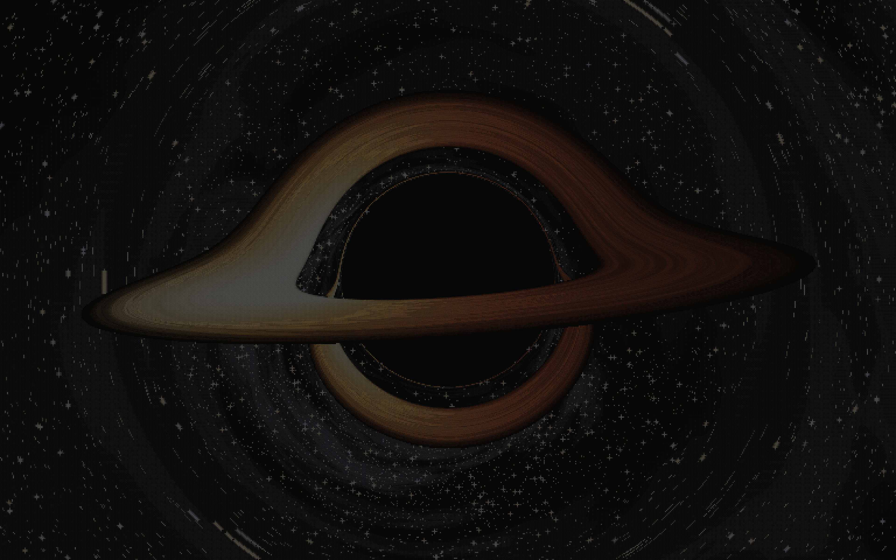

# Tokonoma

床の間: the alcove in a Japanese room where a single scroll hangs and gets
changed with the seasons. Tokonoma does that for the macOS desktop.

It's a free live-wallpaper app for macOS, a bit like Wallpaper Engine. Every
scene is animated and drawn as a woven grid of glyphs, blocks or dots, and sits
behind your desktop icons on every display and every Space.



## What's in it

- **Over 400 animated scenes.** Most are Japanese: shrines, koi ponds, bamboo
  in the rain, snowy villages, festivals, crafts and patterns. A Chinese tab
  holds about 80 more: mountains, water towns, ink painting and festivals.
  Many scenes follow your clock and the season.
- **Your own wallpapers.** Drop in any video, gif or picture (mp4, mov, webm,
  gif, png, jpg, webp, heic, avif, tiff…) and it gets woven the same way.
- **Settings for every scene**, with a live preview: the weave (glyph, block or
  dot), the glyph set, the cell size, and scene-specific controls such as wind,
  season or rain.
- **Favourites and rotation.** Star the scenes you like, and Tokonoma can move
  to the next one every so often.
- **Light on battery.** Scenes pause when a window covers them, when the screen
  sleeps or the Mac locks, in Low Power Mode, and when the Mac runs hot. On
  battery they drop to fewer frames.
- **Out of the way.** It lives in the menu bar (the small torii). It only
  appears in the Dock and Cmd-Tab while its library window is open.
- **Make scenes with an AI agent** (optional). A built-in MCP server lets Claude,
  ChatGPT, Cursor or any MCP client design new scenes on your Mac. Set it up in
  the Agents tab. It needs [Node.js](https://nodejs.org).

## Install

You need macOS 14 or later.

### Download

1. Get `Tokonoma.zip` from the [latest release](https://github.com/Raff407/tokonoma/releases/latest).
2. Unzip it and drag **Tokonoma** into Applications.
3. The app isn't notarised by Apple, so macOS will block the first launch. Open it
   once, then go to **System Settings → Privacy & Security** and click
   **Open Anyway**. Or run this:

   ```bash
   xattr -dr com.apple.quarantine /Applications/Tokonoma.app
   ```

### Build it yourself

You need Xcode.

```bash
git clone https://github.com/Raff407/tokonoma.git
cd tokonoma
scripts/bundle.sh --install   # builds, signs locally, copies to /Applications
```

## Using it

- Open Tokonoma and the library appears. Click a scene to preview it.
- **Hang on every display** sets the wallpaper. **One display** gives each screen
  its own scene.
- Drag videos or pictures onto the library to add your own.
- Settings covers when it rests, the frame rate, rotation, displays and
  opening at login.
- Close the window and Tokonoma keeps running in the menu bar.

## How it works

Each scene paints a tiny picture, one pixel per cell, with the ordinary canvas
API. **kasuri** (絣, the weave where threads are dyed before they meet) turns
every cell into a glyph, block or dot in a single WebGL2 shader pass, so the
CPU barely works. A native Swift app puts one borderless window per screen at
the desktop level and runs the scene inside it with WebKit.

```
Wallpapers/        the scenes (wallpaper.json + scene.js each) and kasuri in _lib/
Sources/           the Swift app: core logic, desktop windows, library UI
market/            the shared wallpaper checks and the MCP server for agents
```

Scenes run sandboxed: no network, and they can only read their own folder.

### Make your own scene

A scene is a folder in `~/Library/Application Support/Tokonoma/Wallpapers` with a
`wallpaper.json` and a `scene.js` that calls `Kasuri.run({ defaults, setup, draw })`.
Properties you declare in the manifest show up as controls in the library.
The easiest way to start is to ask an agent through the MCP server, or copy an
existing scene.

## Development

```bash
xcrun swift test                # Swift
cd web && npm test              # kasuri
cd market && npm test           # wallpaper checks
xcrun swift scripts/bench.swift # ms per frame for every scene
```

## Licence

MIT, see [LICENSE](LICENSE).

## Credits

The nudity check on imported packages uses the
[NSFWDetector](https://github.com/lovoo/NSFWDetector) Core ML model by LOVOO
(BSD-3-Clause). Its licence is in `Resources/Models`.
